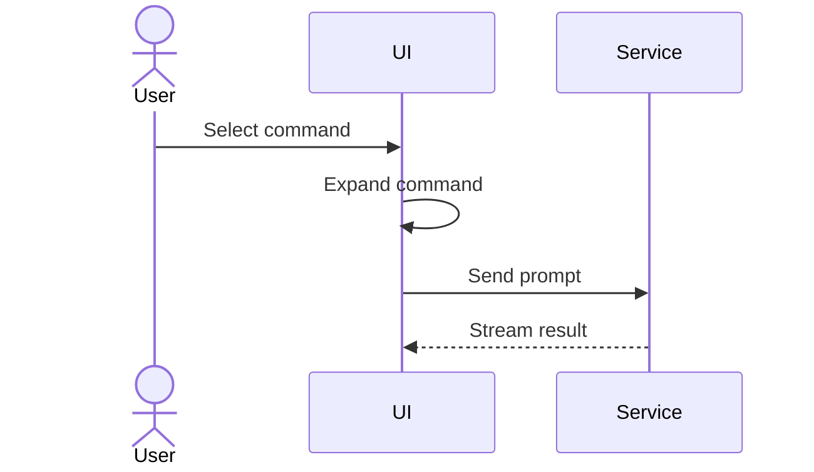

# Output Shape Examples

These fictional examples show concrete visual shapes for `explain`. Replace their names, paths, and facts with those of the current topic. Never output every form at once, and write user-facing prose and labels in the selected response language.

## Decision logic: pseudocode

If the content is unchanged, return the cached result. Otherwise, save the content and return the new result.

```text
Pseudocode:
on(save)
  if content is unchanged
    return cached result
  write new content
  return fresh result
```

## Call order: call tree

Create the session before opening its page. During session creation, save the prompt before launching the agent.

```text
Illustrative call tree (siblings appear in execution order):
submitForm
├── createSession
│   ├── persistPrompt
│   └── launchAgent
└── navigateToSession
```

## UI structure: component tree

The page owns the run state. The toolbar starts the action, and the timeline displays the results.

```text
Component sketch (not executable JSX):
<SessionPage> (src/routes/session.tsx)
  useSessionEvents() → runState
  <SessionToolbar onRun={startRun} />
  <SessionTimeline state={runState} />
```

## File responsibilities: shallow file tree

The command module parses actions, the session module manages state, and the transport module handles network communication.

```text
Illustrative directory structure:
src/
├── commands/       # Parses user actions
├── sessions/       # Manages session state
└── transport/      # Handles network communication
```

## Component interaction: Mermaid

In this example, the UI expands the command before sending the prompt to the service. The service streams the result back.



## Local changes: diffs that match the subject

Component change sketch: add a run button to the toolbar and a result card to the timeline.

```diff
 <SessionPage>
   <SessionToolbar>
+    <RunSkillButton />
   <SessionTimeline>
+    <SkillResultCard />
```

Directory change sketch: split the transport file into request and event modules.

```diff
 src/
 ├── commands/
 ├── sessions/
-└── transport.ts
+└── transport/
+    ├── client.ts
+    └── events.ts
```

Call change sketch: expand the skill mention before launching the agent. During navigation, subscribe to events after opening the page.

```diff
 submitForm
   createSession
     persistPrompt
+    expandSkillMention
     launchAgent
   navigateToSession
+    subscribeToEvents
```

Logic change sketch: add an early return. Write to storage only when the content changes.

```diff
 on(save)
+  if content is unchanged
+    return cached result
   write new content
   return fresh result
```

## Complete target: full code block

When the user needs a complete copyable function, show the full implementation. This TypeScript example assumes the input always starts with `/`.

```ts
function expandSkill(command: string): string {
  const skillName = command.slice(1);
  return `use the ${skillName} skill`;
}
```

## Visual layout: focused HTML

Request: “Show how the Save button differs while saving and after a failed save.”

Output shape: create one page that displays both states side by side. Show a disabled button and progress message while saving. Show the error and a retry action after failure. Stack the states on narrow screens. Use verified UI copy; label proposed designs as proposals. Save and open the HTML and provide its file link instead of only describing the planned page.
